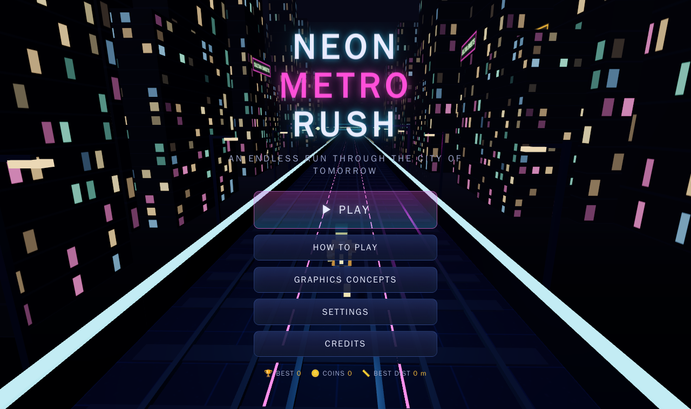
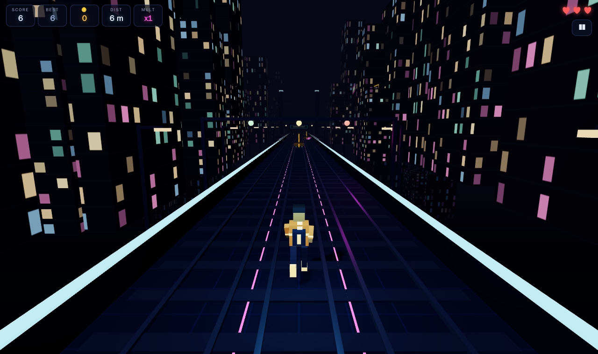
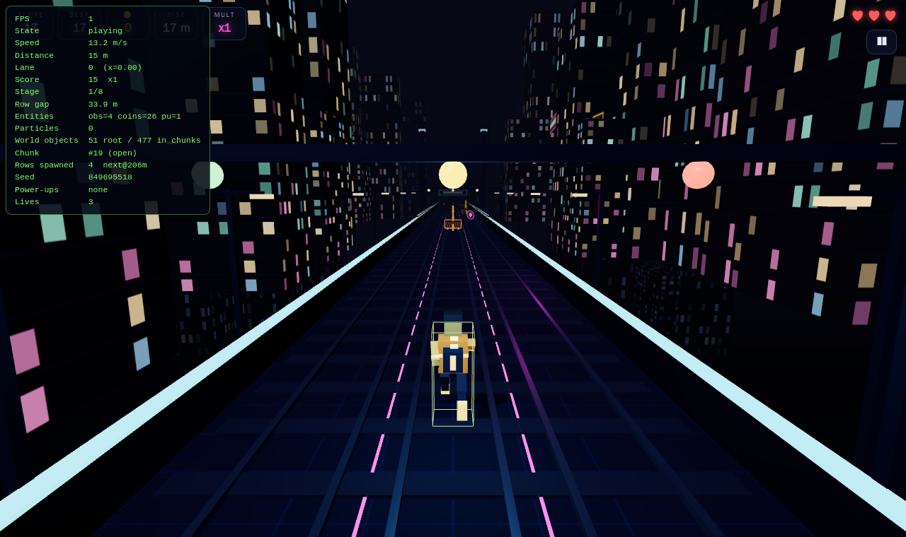
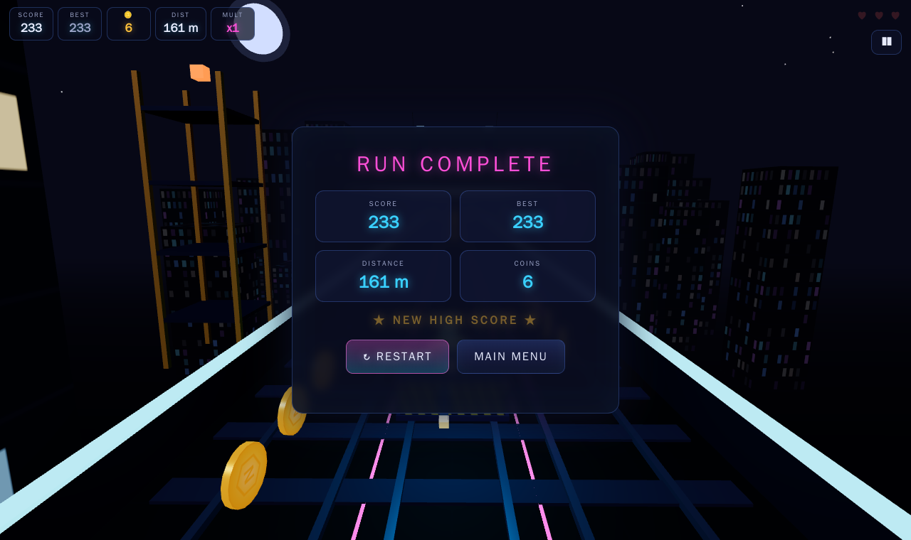

#  NEON METRO RUSH

**An original 3D endless runner through a futuristic Indian metro city at night.**
Built with **TypeScript · Vite · Three.js · Web Audio API · Vitest** as a Computer Graphics major project.

> 100% original assets: every texture, model, character and sound is generated
> procedurally at runtime. No third-party art, audio, characters or branding.

---

## ✨ Features

- **Third-person lane runner**: 3 lanes, jump, slide, lean, 3-life system with post-hit invincibility
- **Procedural endless city**: recycled chunks — open track, tunnels, neon stations, night markets, suspension bridges, construction zones
- **Fair procedural generation**: seeded PRNG (reproducible runs), template-based obstacle rows that are *mathematically validated* to always leave a passable route, grace gaps after forced lane switches
- **4 power-ups**: Coin Magnet, Shield, x2 Score, Jet Boost — each with HUD chip, countdown bar, 3D visual effect and end-of-effect feedback
- **Original procedurally animated character**: run cycle, jump tuck, slide crouch, hit stagger, hoverboard pose, 3 colour variants
- **Score & progression**: distance score, coin bonus, clean-run multiplier up to x5, rising difficulty stages, localStorage persistence (high score / coins / best distance)
- **Full UI**: loading screen with progress, main menu, how-to-play, graphics-concepts explainer, settings, credits, pause, game over, toasts, debug overlay (F3)
- **Procedural audio**: music + all SFX synthesised live via Web Audio API (zero audio files), volume/mute controls, autoplay-policy compliant
- **Graphics quality presets** (Low / Medium / High): pixel ratio, shadows, fog & draw distance, particle cap, decoration density, chunk ring size
- **Robust engineering**: object pooling everywhere, instanced meshes, clamped delta time, tab-hidden auto-pause, defensive localStorage/WebGL/fullscreen/audio handling
- **Desktop + mobile**: keyboard and swipe controls, responsive neon UI

## 🛠 Technology Stack

| Layer      | Choice |
|------------|--------|
| Language   | TypeScript 5.6 (strict) |
| Bundler    | Vite 5 |
| 3D engine  | Three.js r169 |
| Audio      | Web Audio API (procedural synthesis) |
| Testing    | Vitest (unit) + Playwright (headless E2E smoke) |
| Linting    | ESLint 9 flat config + typescript-eslint |
| Backend    | none (fully static) |

## 🚀 Installation

```bash
npm install
npm run dev        # development server → http://localhost:5173
```

## 📦 Production build

```bash
npm run build      # type-check + bundle into dist/
npm run preview    # serve the production build → http://localhost:4173
```

The build uses a **relative base path**, so `dist/` can be dropped into any
static host or sub-directory without configuration changes.

## ✅ Development commands

```bash
npm run lint       # ESLint over src/ + tests/
npm run test       # Vitest unit tests (pure logic)
npm run typecheck  # tsc --noEmit
npm run build      # tsc + vite build
```

## 🎮 Controls

| Action        | Desktop                        | Mobile            |
|---------------|--------------------------------|-------------------|
| Move left     | `←` / `A`                      | swipe left        |
| Move right    | `→` / `D`                      | swipe right       |
| Jump          | `↑` / `W` / `Space`            | swipe up / tap    |
| Slide         | `↓` / `S`                      | swipe down        |
| Pause / Resume| `P` / `Esc`                    | ❚❚ button         |
| Restart       | `R`                            | —                 |
| Debug overlay | `F3`                           | —                 |

Game gestures call `preventDefault()` so the page never scrolls mid-run.

## 🏗 Architecture

```
src/
  core/        Game (state machine) · GameLoop · InputManager · AudioManager
               SettingsManager · StorageManager
  entities/    Player (procedural rig) · Obstacle · Coin · PowerUp
  systems/     CollisionSystem · SpawnSystem · PatternPlanner · DifficultySystem
               ScoreSystem · PowerUpTimers · ParticleSystem · CameraSystem · ObjectPool
  world/       World (renderer/lights/fog) · TrackManager (chunk recycling)
               ChunkGenerator · EnvironmentFactory · Textures (procedural canvas art)
  ui/          UIManager (all DOM) — screens live in index.html, styles in styles/main.css
  config/      gameConfig.ts — every tunable gameplay/graphics value
  utils/       math (seeded RNG, damp) · dispose · constants
tests/         Vitest suites for score, difficulty, patterns, lanes, collision,
               power-ups, storage parsing, config validation, pooling, chunk RNG
```

Design rules honoured throughout:

- **Single source of truth** for balance values (`config/gameConfig.ts`).
- **Pure logic modules** (score, difficulty, patterns, timers, collision math) have no Three.js imports → unit-testable.
- **UI is DOM-only**, simulation is WebGL-only; they meet through callbacks + `CustomEvent`s.
- **Zero mid-run allocation**: pooled entities/particles, shared geometry & materials, cloned decor prototypes.
- **Correct disposal** via `utils/dispose.ts` and per-system `dispose()` methods.

## 🎓 Computer graphics concepts demonstrated

Open **Graphics Concepts** in the game menu for presentation-ready notes.
Highlights: hierarchical transformations, perspective projection & look-at camera,
procedural canvas texture mapping/UVs, hemisphere+directional+point lighting,
PBR (MeshStandardMaterial) vs unlit emissives, real-time shadow mapping,
linear fog, additive alpha blending, custom-GLSL point-sprite particles,
AABB collision with pose-dependent boxes, seeded procedural generation,
object pooling, InstancedMesh, distance/quality-based LOD budgeting,
clamped delta-time animation, ACES tone mapping + sRGB output.

## ⚡ Performance optimisations

- Object pooling for obstacles, coins, power-ups, particles **and whole track chunks**
- Shared unit-box geometry + cached materials (environment factory)
- `InstancedMesh` for sleepers, skyline buildings, bridge city lights
- One shadow-casting light with a tight ortho frustum around the player
- Capped device-pixel-ratio per quality preset
- Broad-phase Z reject before AABB tests; throttled HUD updates (~12 Hz)
- Delta-time clamped to 50 ms; exponential damping for frame-rate independence
- Simulation frozen while paused / tab hidden

## 🧪 Testing

- `npm run test` — 74 unit tests (fairness fuzzing of 6 000+ generated rows included)
- `e2e/smoke.mjs` — optional headless-Chromium E2E gate (Playwright, installed on demand):
  boots the production build, plays a full run — menu → play → lanes/jump/slide →
  collisions → game over → restart → settings persistence → touch swipe → resize —
  and asserts **zero console errors**.
  ```bash
  npm i -D playwright && npx playwright install --with-deps chromium
  npm run build && (npm run preview &) && node e2e/smoke.mjs
  ```
  Touch is injected via CDP where the browser allows it; on headless software
  renderers that block touch injection the suite falls back to synthetic
  `TouchEvent`s dispatched through the real input handlers (same code path).
- `e2e/beauty.mjs` — re-captures the documentation screenshots.
- `AI_HANDOFF.md` — complete machine-to-machine project context dump.

## 📸 Screenshots

| Menu | Gameplay |
|------|----------|
|  |  |

| Debug overlay | Game over |
|---------------|-----------|
|  |  |

## 🌍 Deployment (static)

- **GitHub Pages**: build → publish `dist/` (see `.github/workflows/deploy.yml`).
  Relative base means project pages (`/repo-name/`) work unchanged.
- **Vercel**: import repo → framework "Vite" → build `npm run build`, output `dist`.
- **Netlify**: build command `npm run build`, publish directory `dist`.
- Any static file server: copy `dist/`.

No localhost paths, no environment variables, no secrets.

## ⚠️ Known limitations

- Software renderers (CI / old laptops) run below 60 FPS; use the Low preset.
- Track is straight by design (no curves/banks) to keep collision + generation provably fair.
- Shadows cover the player neighbourhood only (intentional light-budget decision).
- Character animation is procedural (no rigged skinned mesh / no mocap).
- Music is a simple procedural loop, not a composed soundtrack.

## 🔭 Future improvements

- Curved track segments via spline-based chunk warping
- Skinned-mesh character with blend-shape facial animation
- Optional bloom/DOF post-processing toggle (EffectComposer) on High preset
- Daily-seed leaderboard via URL hash (no backend)
- Gamepad support and full accessibility pass (screen-reader announcements)
- WebGPU renderer path

## 📄 License & credits

Code: MIT (see `LICENSE`). All assets are original procedural content — see
`ASSET_CREDITS.md`. Third-party libraries: Three.js (MIT), TypeScript (Apache-2.0),
Vite (MIT), Vitest (MIT), ESLint (MIT).
